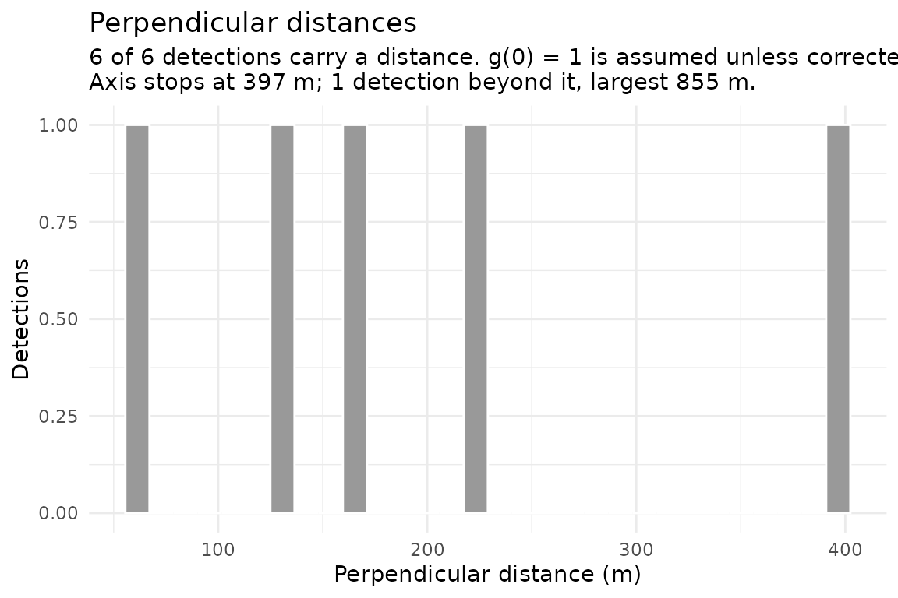

# From segments to a density surface

``` r

library(distsamp)
```

`distsamp` stops at segments. This vignette starts where
[`vignette("segmenting-narwc-data")`](https://camilleross.org/distsamp/articles/segmenting-narwc-data.md)
ends and passes the output to `Distance` and `dsm`. The two places this
handoff usually goes wrong are units and the key between segments and
detections.

The `Distance` and `dsm` chunks are **not evaluated**. Neither package
is a dependency of `distsamp`, so the vignette builds without them. The
code runs once they are installed.

**The data is synthetic.** `narwc-example.csv` is generated by
`data-raw/make-fixture.R`. No real NARWC records are distributed with
the package or were used to develop it. The fixture has two days, seven
tracks, and a few sightings: far too few to fit a detection function or
a density surface. The numbers below show the mechanics only; none is a
result.

## Segment the survey

``` r

path <- system.file("extdata", "narwc-example.csv", package = "distsamp")
dat <- read_narwc(path)
#> `read_narwc()` renamed 2 columns:
#>   LAT_DD  -> LATITUDE
#>   LONG_DD -> LONGITUDE
#> All matched an exact entry in the alias table; `narwc_column_mapping()` returns this, and `quiet = TRUE` silences it.
segs <- segment_survey(dat, seg_length = 5, seed = 1, species = "RIWH")
segs
#> <distsamp_segments>
#>   segments:  20
#>   tracks:    7
#>   total effort: 92.23 km
#>   segment length: median 4.44 km, range 2.22-7.78 km
#>   target length: 5 km   seed: 1
#>   species:   RIWH
#>   detections: 6 (6 with a perpendicular distance, m)
```

Two tables are used here.

**`segments`** holds the sampling units, one row each, with effort and a
location:

``` r

head(segs$segments[, c("seg_id", "seg_eff", "mid_lat", "mid_lon", "wt_beaufort")])
#> # A tibble: 6 × 5
#>   seg_id         seg_eff mid_lat mid_lon wt_beaufort
#>   <chr>            <dbl>   <dbl>   <dbl>       <dbl>
#> 1 2024-04-01_2_1    7.78    43.0   -69             2
#> 2 2024-04-01_2_2    5.56    43.1   -69             2
#> 3 2024-04-01_2_3    3.33    43.1   -69             2
#> 4 2024-04-01_2_4    5.56    43.2   -69             2
#> 5 2024-04-01_4_1    4.44    43.3   -69.1           2
#> 6 2024-04-01_4_2    3.33    43.3   -69.1           2
```

**`detections`** holds one row per sighting, with its perpendicular
distance:

``` r

segs$detections[, c("seg_id", "SPECCODE", "size", "distance", "side")]
#> # A tibble: 6 × 5
#>   seg_id         SPECCODE  size distance side 
#>   <chr>          <chr>    <dbl>    <dbl> <chr>
#> 1 2024-04-01_2_1 RIWH         1    229   right
#> 2 2024-04-01_2_2 RIWH         2    132.  left 
#> 3 2024-04-01_2_2 RIWH         1    397.  right
#> 4 2024-04-01_4_2 RIWH         3     61.4 left 
#> 5 2024-04-01_4_2 RIWH         2    855.  right
#> 6 2024-04-02_1_3 RIWH         4    160.  left
```

`seg_id` is the key between them. Every detection belongs to exactly one
segment, and that segment carries the effort the detection was made on.

## Match the units

Mismatched units are the most common way to get a density estimate wrong
by a factor of 1000.

``` r

c(effort = "km", distance = segs$settings$distance_units)
#>   effort distance 
#>     "km"      "m"
```

`seg_eff` is in **kilometres**, because effort accumulates in km.
`distance` defaults to **metres**, because `ALT` is in metres (handbook
8.A.1) and aerial cetacean surveys conventionally report perpendicular
distances in metres.

There are two options. Work in kilometres throughout:

``` r

segs_km <- segment_survey(dat, seg_length = 5, seed = 1, species = "RIWH",
                          distance_units = "km")
segs_km$detections$distance
#> [1] 0.22900000 0.13221321 0.39663963 0.06136037 0.85463963 0.16034753
```

Or keep metres and pass a conversion factor to `Distance` as
`convert_units`. For distance in m, effort in km, and area in km², the
factor is:

``` r

# distance in m, effort in km, area in km^2: m -> km
convert_units <- 0.001
```

The same factor goes to `dsm()` as `convert.units`. State the choice in
your methods.

## Plot the distances

Look at the distribution before fitting a curve to it.

``` r

plot(segs, what = "distances")
```



Expect a shoulder near zero and a tail that falls away. What you see
changes what you fit:

- **A dip in the first bin** may not be a sampling artefact. An aircraft
  cannot see the water directly beneath it. For the Skymaster, handbook
  8.A.31 says CETAP-era distances “are actually measured from about 1/8
  mile to either side of the survey line”. Use left truncation,
  `ds(left = ...)`; do not assume the animals were absent.
- **A peak away from zero** is what the gamma key function describes.
  [`Distance::ds()`](https://rdrr.io/pkg/Distance/man/ds.html) does not
  offer it (only `hn`, `hr`, and `unif`); use
  `mrds::ddf(key = "gamma")`. A gamma key and left truncation model the
  same blind spot, so using both counts it twice.
- **A long flat tail** calls for stronger truncation.
- **A distance the aircraft could not have seen** is a broken record,
  not a wide detection: a sighting matched to the wrong segment, or a
  coordinate with a lost sign. The axis stops at the 99th percentile so
  one such value cannot push every real distance into the first bin. The
  subtitle reports how many lie beyond it and how large the largest is.
  If the largest is too far to be a detection, fix it before fitting.
  [`?sighting_distances`](https://camilleross.org/distsamp/reference/sighting_distances.md)
  says where each distance comes from.

The plot says nothing about `g(0)`, the probability of detecting an
animal on the track-line. Animals submerged when the aircraft passed
leave no trace here. A smooth curve is equally consistent with half of
them having been invisible.

## Fit a detection function

[`Distance::ds()`](https://rdrr.io/pkg/Distance/man/ds.html) takes a
data frame with a `distance` column and, optionally, `size` and
detection covariates.
[`detection_data()`](https://camilleross.org/distsamp/reference/detection_data.md)
builds that table, often called a *flatfile*:

``` r

flat <- detection_data(
  segs,
  area = 5811,                    # square km - yours to supply
  covariates = "wt_beaufort"
)
#> `detection_data()`: 20 segments, 6 detections (m).
#>   g(0) = 1 is assumed; see `?detection_data`.
head(flat)
#> # A tibble: 6 × 9
#>   Region.Label  Area Sample.Label   Effort object distance  size distance_source
#>   <chr>        <dbl> <chr>           <dbl>  <int>    <dbl> <dbl> <chr>          
#> 1 all           5811 2024-04-01_2_1   7.78      1     229      1 angle          
#> 2 all           5811 2024-04-01_2_2   5.56      2     132.     2 angle          
#> 3 all           5811 2024-04-01_2_2   5.56      3     397.     1 angle          
#> 4 all           5811 2024-04-01_2_3   3.33     NA      NA     NA NA             
#> 5 all           5811 2024-04-01_2_4   5.56     NA      NA     NA NA             
#> 6 all           5811 2024-04-01_4_1   4.44     NA      NA     NA NA             
#> # ℹ 1 more variable: wt_beaufort <dbl>
```

``` r

library(Distance)

df <- ds(flat, key = "hn", truncation = "10%", formula = ~ wt_beaufort,
         convert_units = 0.001)   # distances in m, effort in km

summary(df)
plot(df)
gof_ds(df)
```

Points to note:

**`area` is required and has no default.** It scales abundance directly.
The scripts this package was rewritten from had 5,811 km² written into
the middle of a function, which is how a study-area figure outlives its
study.

**Segments with no detections are in the table, with a missing
`distance`.**

``` r

sum(is.na(flat$distance))
#> [1] 16
```

These rows are not padding. They record effort that produced no
sightings. Dropping them removes part of the denominator and inflates
density.

**Use `wt_beaufort`, not `mean_beaufort`.** `wt_beaufort` weights each
record by the distance it covers, so a sea state held over 3 km counts
for more than one recorded over 200 m. Detection depends on that
quantity.

**Circling detections are excluded by default**, and the exclusion is
reported. A position logged off the track is not measured at the moment
of detection. The animals still count towards the segment’s abundance,
so `segs$sightings` is unchanged. Excluding a detection from the
detection function while counting it towards density is normal, and the
two are separate arguments:

``` r

nrow(detection_data(segs, area = 5811, include_circling = TRUE))
#> `detection_data()`: 20 segments, 6 detections (m).
#>   g(0) = 1 is assumed; see `?detection_data`.
#> [1] 22
```

**Check the source of each distance.** The methods must state it, and
point and interval distances cannot be fitted together:

``` r

table(flat$distance_source, useNA = "no")
#> 
#> angle 
#>     6
```

**Truncation drops detections, not effort.** The `truncation` argument
of
[`detection_data()`](https://camilleross.org/distsamp/reference/detection_data.md)
drops detections beyond it and keeps their segments with effort intact:
searched effort counts whether or not anything was seen within the
truncation distance. Pass the same value to
[`ds()`](https://rdrr.io/pkg/Distance/man/ds.html). Otherwise the model
is fitted to one set of detections and abundance is scaled by another.

``` r

nrow(detection_data(segs, area = 5811, truncation = 500))
#> `detection_data()`: 20 segments, 5 detections (m).
#>   dropped 1 beyond the truncation distance; their segments keep their effort
#>   g(0) = 1 is assumed; see `?detection_data`.
#> [1] 21
```

### Compare models

Fitting a set of models and choosing the best has two traps.

**AIC only compares models fitted to the same data.** Changing the
truncation changes which detections are in the likelihood, so AICs
across truncations are not comparable. Vary key function, adjustments,
and covariates at a fixed truncation. Compare truncations separately.

**Binned and unbinned fits cannot share a table.** `STRIP` distances are
intervals and are fitted binned. Angle- and position-derived distances
are points. A multi-year model set therefore splits along that line.

Rank on more than AIC. Abundance depends on the effective strip
half-width, and two models within 2 AIC of each other can give
materially different values of it. Report $`\bar{p}`$ (average detection
probability) and its CV alongside AIC, with a goodness-of-fit statistic.

`docs/07-fitting-architecture.md` in the package repository covers this,
where an automated model-selection sweep belongs, and what can and
cannot be done about `g(0)`.

## Project the coordinates

`mid_lon`/`mid_lat` are decimal degrees. A smooth of longitude and
latitude in degrees distorts distance at NARWC latitudes: at 43°N a
degree of longitude is about 81 km, against 111 km for a degree of
latitude. Project to an equal-area projection before modelling:

``` r

pts <- segments_as_sf(segs, "midpoints")

# Albers equal-area, Gulf of Maine
gom_aea <- paste(
  "+proj=aea +lat_1=40 +lat_2=46 +lat_0=43 +lon_0=-69",
  "+x_0=0 +y_0=0 +datum=WGS84 +units=km +no_defs"
)
projected <- sf::st_transform(pts, gom_aea)

xy <- sf::st_coordinates(projected)
head(xy)
#>              X         Y
#> [1,]  0.000000  3.893573
#> [2,]  0.000000 10.568327
#> [3,]  0.000000 15.018201
#> [4,]  0.000000 19.468104
#> [5,] -8.107262 30.041539
#> [6,] -8.102634 33.935268
```

## Build the `dsm` inputs

`dsm` needs two data frames with fixed column names. They map directly
from `distsamp` output:

``` r

library(dsm)

segment.data <- data.frame(
  Sample.Label = segs$segments$seg_id,
  Effort       = segs$segments$seg_eff,   # km
  X            = xy[, 1],                 # projected, km
  Y            = xy[, 2],
  beaufort     = segs$segments$wt_beaufort
)

# The detections the detection function was actually fitted to, after
# truncation, so `object` matches.
fitted <- df$ddf$data
observation.data <- data.frame(
  object       = fitted$object,
  Sample.Label = fitted$Sample.Label,
  size         = fitted$size,
  distance     = fitted$distance
)
```

`object` is the detection identifier from
[`detection_data()`](https://camilleross.org/distsamp/reference/detection_data.md).
`dsm` uses it to link each detection to its row in the fitted detection
function. Taking the rows from `df$ddf$data` keeps the two consistent
after truncation.

## Add covariates

`distsamp` gives each segment a location and nothing else. Environmental
covariates, such as depth, sea surface temperature (SST), and fronts,
must be sampled at each segment midpoint by the user.
`segments_as_sf(segs, "midpoints")` is the intended handoff:

``` r

pts <- segments_as_sf(segs, "midpoints")

# e.g. with terra
depth <- terra::extract(bathymetry_raster, terra::vect(pts))
segment.data$depth <- depth[, 2]
```

Sample at the **midpoint**, as Becker et al. (2019) do: covariates
“derived based on the segment’s geographical mid-point”, with SST and
depth standard deviations taken over a 3 × 3-pixel box around it.
[`segment_midpoints()`](https://camilleross.org/distsamp/reference/segment_midpoints.md)
places the midpoint half the segment’s *effort* along the track, not at
the centroid of its records, so it lies on the trackline.

Match covariates in **time** as well as space. A segment flown in April
needs April’s SST, not the annual mean. `segs$segments$DATE` holds the
survey date for this.

## Fit the density surface model

``` r

mod <- dsm(
  count ~ s(X, Y, bs = "ts") + s(depth, bs = "ts"),
  ddf.obj = df,
  segment.data = segment.data,
  observation.data = observation.data,
  family = tw(),          # Tweedie handles the zero inflation
  method = "REML",
  convert.units = 0.001   # distances in m, effort in km
)

summary(mod)
plot(mod)
gam.check(mod)
```

A Tweedie or negative binomial family is usually appropriate: most
segments hold no animals, and the non-zero counts are overdispersed.
Miller et al. (2013) discuss the choice.

## Report the settings

Record the `seed`. Without it the segmentation is not reproducible, and
neither is anything downstream.

``` r

str(segs$settings)
#> List of 13
#>  $ seg_length         : num 5
#>  $ species            : chr "RIWH"
#>  $ seed               : num 1
#>  $ seg_tol_frac       : num 0.5
#>  $ min_track_km       : num 1
#>  $ min_segment_km     : num 1
#>  $ dist_method        : chr "haversine"
#>  $ circling           : chr "same_species"
#>  $ circling_distance  : chr "with_group"
#>  $ circling_max_gap_km: num 5
#>  $ distance_units     : chr "m"
#>  $ platform           : chr "aerial"
#>  $ distance_sources   : chr [1:3] "angle" "exact" "strip"
```

Suggested methods wording is in `docs/06-references.md` in the package
repository.

## References

Becker, E.A., Forney, K.A., Ferguson, M.C., Foley, D.G., Smith, R.C.,
Barlow, J. and Redfern, J.V. (2010) Comparing California Current
cetacean-habitat models developed using in situ and remotely sensed sea
surface temperature data. *Marine Ecology Progress Series* 413:163-183.
<https://doi.org/10.3354/meps08696>

Becker, E.A., Forney, K.A., Redfern, J.V., Barlow, J., Jacox, M.G.,
Roberts, J.J. and Palacios, D.M. (2019) Predicting cetacean abundance
and distribution in a changing climate. *Diversity and Distributions*
25:626-643. <https://doi.org/10.1111/ddi.12867>

Hedley, S.L. and Buckland, S.T. (2004) Spatial models for line transect
sampling. *Journal of Agricultural, Biological, and Environmental
Statistics* 9:181-199. <https://doi.org/10.1198/1085711043578>

Miller, D.L., Burt, M.L., Rexstad, E.A. and Thomas, L. (2013) Spatial
models for distance sampling data: recent developments and future
directions. *Methods in Ecology and Evolution* 4:1001-1010.
<https://doi.org/10.1111/2041-210X.12105>

Miller, D.L., Rexstad, E., Thomas, L., Marshall, L. and Laake, J.L.
(2019) Distance sampling in R. *Journal of Statistical Software*
89(1):1-28. <https://doi.org/10.18637/jss.v089.i01>
